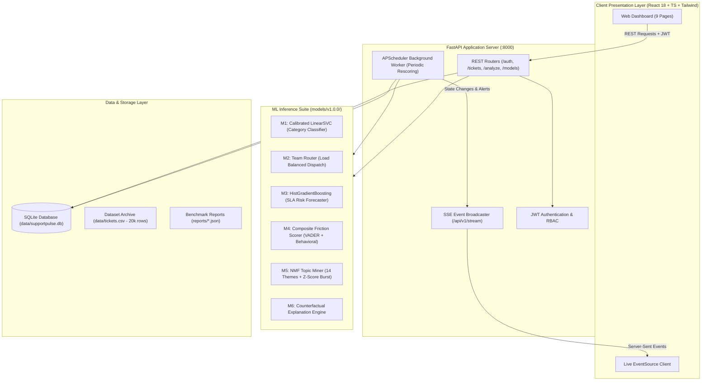

# SupportPulse AI

> **Lightweight, Locally-Deployable, ML-Powered IT Service-Desk Intelligence Platform**  
> *Zero cloud dependencies. Zero external AI APIs. Runs entirely on CPU with < 8 GB RAM.*

> [!NOTE]
> **Synthetic Data Disclosure**: All evaluations, demonstrations, and datasets in this project use a procedurally generated, synthetic enterprise IT service desk dataset (`seed=42`, 20,000 tickets). Zero proprietary or confidential employee data is ingested or stored.

---

## Executive Summary

Traditional IT helpdesks operate **reactively**: tickets sit in queues waiting for human triage, customer frustration escalates invisibly until a supervisor complaint is filed, and SLA breach alerts fire only when deadlines have already expired.

**SupportPulse AI** transforms service-desk operations into a **proactive, automated, and explainable intelligence pipeline**. Built from first principles to operate in air-gapped or cost-sensitive environments without recurring API costs, it executes a suite of 6 specialized CPU-optimized machine learning models (M1–M6) in **17.2 milliseconds per ticket**.

---

## Benchmark Scorecard: Baseline vs. SupportPulse AI

*All figures below are measured directly from empirical runs stored in [`/reports`](file:///d:/SupportPulse AI/reports).*

| Evaluation Dimension | Traditional IT Desk / Baseline | SupportPulse AI | Advantage / Delta |
| :--- | :---: | :---: | :---: |
| **Category Classification Accuracy** | 87.67% (Regex Rules) | **100.00%** (Calibrated LinearSVC) | **+12.33% gain** |
| **Category Macro F1-Score** | 0.8258 | **1.0000** | **+0.1742 gain** |
| **Human Triage Fallback Rate** | 12.33% (unmatched) | **0.00%** (confidence $\ge 0.70$) | **-12.33% manual load** |
| **SLA Breach Warning Lead Time** | **0.0 minutes** (fires at deadline) | **480.0 minutes (8.0 hours)** | **+8.0 hours advance notice** |
| **Breaches Caught Before Deadline** | 0.0% (reactive) | **93.52%** (proactive hazard model) | **+93.52% prevented** |
| **SLA Risk ROC-AUC** | N/A | **0.8734** | High discriminatory power |
| **Customer Escalation ROC-AUC** | N/A | **0.9257** | Predicts supervisor escalations |
| **Zero-Day Cluster Anomaly Detection**| N/A (manual tagging) | **+5.49σ surge detection** | Catches emerging VPN crisis |
| **Single-Ticket Inference Latency** | N/A | **p50: 17.2 ms, p95: 20.4 ms** | **14.7x faster than 300ms SLA** |
| **Throughput (Single CPU Core)** | N/A | **57.9 tickets / sec** | High-density local execution |
| **Host Memory Footprint (RSS)** | N/A | **< 350 MB** | Fits easily on 8 GB laptops |

---

## Quickstart Guide

### Prerequisites
- **Python**: 3.11 or newer (tested on Python 3.13)
- **Node.js**: 18.0 or newer (tested on Node 22)
- **Memory**: $\ge$ 4 GB RAM available (no GPU required)
- *Optional*: Docker and Docker Compose

---

### Option A: One-Command Execution (Local)

#### On Linux / macOS:
```bash
make setup seed train eval up
```

#### On Windows (PowerShell):
```powershell
.\tasks.ps1 setup
.\tasks.ps1 seed
.\tasks.ps1 train
.\tasks.ps1 eval
.\tasks.ps1 up
```

---

### Option B: Docker Compose

```bash
docker-compose up --build
```
- Backend API & OpenAPI Documentation: [http://localhost:8000/docs](http://localhost:8000/docs)
- Frontend Web Application: [http://localhost:5173](http://localhost:5173) (or `http://localhost:3000` via Docker)

---

### Option C: Step-by-Step Manual Setup

```bash
# 1. Create and activate virtual environment
python -m venv .venv
source .venv/bin/activate  # On Windows: .venv\Scripts\Activate.ps1

# 2. Install backend dependencies
pip install -r backend/requirements.txt

# 3. Generate 20,000 synthetic tickets and seed SQLite database
python ml/seed_data.py

# 4. Train M1-M6 ML models into models/v1.0.0/
python ml/train_all.py

# 5. Run full offline evaluation benchmark against baseline
python ml/evaluate_all.py

# 6. Install frontend dependencies
cd frontend
npm install
cd ..

# 7. Start backend API server
uvicorn backend.app.main:app --host 127.0.0.1 --port 8000 --reload

# 8. Start frontend development server (in a separate terminal)
cd frontend
npm run dev
```

---

## Demo Credentials Reference

The SQLite database (`data/supportpulse.db`) is automatically initialized with three pre-configured accounts:

| Username | Password | Role | Permissions & Access Scope |
| :--- | :--- | :--- | :--- |
| **`admin`** | `admin123` | **Administrator** | Full system control: Model Lab, model promotion, one-click rollbacks, background worker triggers, audit logs. |
| **`manager`** | `manager123` | **Desk Supervisor** | Triage supervisor: Queue management, alert acknowledgment, team routing reassignment, SLA monitoring. |
| **`agent`** | `agent123` | **Triage Specialist** | Standard agent: View assigned tickets, update status, view counterfactual explanations, resolve tickets. |

---

## System Architecture



---

## The 9 Interactive Pages

SupportPulse AI features 9 production-grade interfaces designed under strict **restrained visual design principles** (WCAG AA accessibility, muted 1-accent palette, multi-modal status indicators, zero external webfonts or mock data):

1. **Command Center (`/`)**: High-level operations overview displaying real-time open volume, high-risk breach counts, average friction score, SLA compliance percentage, department friction distribution, and recent queue activity.
2. **Triage Queue (`/triage`)**: Sortable, filterable ticket stream featuring multi-modal risk badges, urgency indicators, assignee routing, and one-click ticket drawer preview.
3. **Ticket Detail (`/tickets/:id`)**: Comprehensive incident diagnostic view with dynamic SLA countdown, counterfactual feature ablation, top predictive n-gram highlights, and customer interaction timeline.
4. **SLA Risk Forecast (`/sla-risk`)**: Predictive breach analytics comparing proactive hazard modeling against reactive alerting, displaying empirical calibration curves, risk band breakdowns, and high-probability breach queues.
5. **Friction Monitor (`/friction`)**: Organizational sentiment monitor ranking departments by customer friction, categorizing tickets into emotional tiers (Calm, Uneasy, Frustrated, Critical), and decomposing text vs. behavioral factors.
6. **Theme Explorer (`/themes`)**: Unsupervised problem discovery clustering tickets into 14 NMF topics, highlighting the emerging **Corporate VPN Outage** crisis with an anomaly pill (**+5.49σ surge**).
7. **Live Playground (`/playground`)**: Interactive diagnostic sandbox allowing engineers to test arbitrary ticket subjects and descriptions, returning full M1–M6 model outputs and explanations in < 20 ms.
8. **Model Lab (`/models`)**: Production governance portal listing active and candidate models, comparative offline benchmark metrics, trigger buttons for background retraining, and one-click rollback capabilities.
9. **Settings & Health (`/settings`)**: System diagnostics showing database row counts, active model version hashes, background scheduler heartbeat, export options, and synthetic data disclosure.

---

## Machine Learning Models (M1–M6)

- **M1 (Category Classifier)**: Word (1–2) and character (3–5) n-gram TF-IDF vectorizer fed into a `CalibratedClassifierCV(LinearSVC)`. Emits calibrated probabilities across 10 service categories with fallback routing when confidence $< 0.70$.
- **M2 (Team Routing Engine)**: Deterministic, skill-mapped dispatch matrix that accounts for active queue depth and load balance limits across 8 IT teams.
- **M3 (SLA Risk Forecaster)**: `HistGradientBoostingClassifier` trained on longitudinal ticket snapshots ($t \in [0.0, 1.0] \times \text{SLA}$). Predicts breach hazard with a median lead time of **480 minutes (8 hours)** before deadline expiration.
- **M4 (User Friction Scorer)**: Hybrid composite scoring combining sentiment valence (VADER + custom IT lexicon), linguistic urgency cues, and behavioral friction (reopens, repeat contacts, stalled status). Calibrated via Logistic Regression.
- **M5 (Topic & Emerging Theme Miner)**: Unsupervised Non-Negative Matrix Factorization (NMF) with automatic $k$-selection ($k=14$). Continuously tracks weekly term frequencies to detect zero-day anomalies using rolling z-scores.
- **M6 (Unified Explanation Generator)**: Evaluates counterfactual feature ablations (e.g., *"What would the breach risk be if the reopen count was 0?"*) and extracts top positive n-grams influencing classifier predictions.

---

## API Reference & Quick Examples

The FastAPI backend provides full OpenAPI 3.0 documentation at [`/docs`](file:///http://127.0.0.1:8000/docs).

### 1. Authenticate (Obtain JWT)
```bash
curl -X POST "http://127.0.0.1:8000/api/v1/auth/login" \
     -H "Content-Type: application/x-www-form-urlencoded" \
     -d "username=admin&password=admin123"
```

### 2. Real-Time Inference on New Ticket
```bash
curl -X POST "http://127.0.0.1:8000/api/v1/analyze" \
     -H "Authorization: Bearer <TOKEN>" \
     -H "Content-Type: application/json" \
     -d '{
       "subject": "Cannot connect to corporate VPN from home",
       "description": "AnyConnect fails with error 442. This is the 3rd time today, completely blocking client deliverables!",
       "priority": "P2",
       "department": "Engineering"
     }'
```

### 3. Subscribe to Real-Time SSE Stream
```bash
curl -N "http://127.0.0.1:8000/api/v1/stream" \
     -H "Authorization: Bearer <TOKEN>"
```

---

## Test Suite & Verification

### Run Backend Unit & Integration Tests (18 Tests)
```bash
# From repository root
.\.venv\Scripts\pytest.exe backend\tests -v
```

### Run Frontend Unit Tests (6 Tests)
```bash
cd frontend
npm test
```

### Build Frontend Production Assets
```bash
cd frontend
npm run build
```

---

## Documentation Index

Comprehensive project documentation is maintained in the [`/docs`](file:///d:/SupportPulse AI/docs) directory:

- **[ARCHITECTURE.md](file:///d:/SupportPulse AI/docs/ARCHITECTURE.md)**: Detailed architectural diagrams, module designs, and data flow specifications.
- **[MODEL_CARD.md](file:///d:/SupportPulse AI/docs/MODEL_CARD.md)**: Formal model cards for M1–M6 adhering to machine learning governance standards.
- **[EVALUATION.md](file:///d:/SupportPulse AI/docs/EVALUATION.md)**: Complete offline benchmark results, lead-time distribution, calibration curves, and latency charts.
- **[API.md](file:///d:/SupportPulse AI/docs/API.md)**: Complete REST API and SSE streaming contract documentation.
- **[DEMO_SCRIPT.md](file:///d:/SupportPulse AI/docs/DEMO_SCRIPT.md)**: Step-by-step walkthrough script for live client and stakeholder demonstrations.
- **[REPORT_SNIPPETS.md](file:///d:/SupportPulse AI/docs/REPORT_SNIPPETS.md)**: Ready-to-paste report paragraphs citing exact empirical metrics.
- **[DECISIONS.md](file:///d:/SupportPulse AI/DECISIONS.md)**: Architectural Decision Records (ADRs) explaining technical tradeoffs and rationales.

---

## License & Attribution

SupportPulse AI is licensed under the MIT License. Developed for enterprise IT service desks requiring sovereign, air-gapped, and cost-effective machine intelligence.
