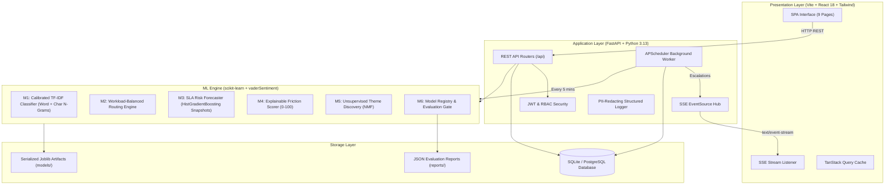
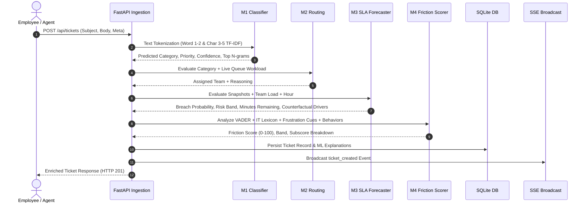

# SupportPulse AI - System Architecture

## 1. Architecture Overview

SupportPulse AI is an on-premises, privacy-first IT service-desk intelligence platform designed to run locally on a single standard workstation (CPU only, <= 8 GB RAM) without external AI APIs or cloud dependencies.

---

## 2. Ingest & Multi-Model Analysis Pipeline

When a ticket is submitted through the API or Webhook, it transitions through a synchronous multi-model inference pipeline completing in **< 25 ms on CPU**:

---

## 3. Machine Learning Modules Architecture

### M1: Multi-Granular Calibrated Classifier
- **Architecture**: `FeatureUnion` combining word n-grams (1-2 words, 12,000 features, sublinear TF) and subword character n-grams (3-5 characters, 15,000 features).
- **Estimator**: `LinearSVC(C=1.0)` wrapped in `CalibratedClassifierCV(method='sigmoid', cv=3)`.
- **Explainability**: Closed-form linear feature weighting:
  $$\text{Score}_i = x_i \times \bar{W}_{c, i}$$
  Extracts the highest-positive contributing n-grams displayed inline in the UI.
- **Safety Gate**: Max probability $< 0.65$ automatically trips `needs_human_triage = True`.

### M2: Workload-Balanced Routing Engine
- **Architecture**: Rule-augmented queue load allocator.
- **Logic**: Primary routing by predicted category, overflowing to secondary teams when primary queue $> 50$ open tickets.

### M3: SLA Risk Forecasting (Zero-Leakage Snapshots)
- **Architecture**: `HistGradientBoostingClassifier(max_leaf_nodes=31, learning_rate=0.08)`.
- **Temporal Snapshot Protocol**: Tickets are sliced at $t \in \{0.0, 0.25, 0.50, 0.75\}$ of elapsed SLA window. Strictly excludes future values such as `resolved_at` or terminal breach status.
- **Counterfactual Ablation**: Quantifies the marginal risk reduction ($\Delta p$) when replacing operational variables (e.g. queue load, off-hours, contact count) with healthy counterfactual baselines.
- **Calibrated Alert Threshold**: Tuned on validation data to achieve a target $\ge 80\%$ recall.

### M4: Explainable Friction Scorer
- **Architecture**: Multi-modal linear combination:
  $$\text{Friction} = w_{\text{sent}} S_{\text{sent}} + w_{\text{cues}} S_{\text{cues}} + w_{\text{behav}} S_{\text{behav}}$$
- **Weights**: Fit via Logistic Regression against supervisor escalation flags:
  - Behavioral cues: $78.9\%$
  - Text frustration cues: $12.3\%$
  - Sentiment polarity: $8.8\%$

### M5: Unsupervised Theme Discovery
- **Architecture**: TF-IDF (8,000 features) + Non-Negative Matrix Factorization (NMF).
- **Auto-K Selection**: Minimizes reconstruction error across candidate $k \in [6, 16]$ (optimal $k=14$).
- **Emerging Anomaly Z-Score**:
  $$z = \frac{\text{Count}_{7\text{d}} - \mu_{28\text{d}}}{\max(\sigma_{28\text{d}}, 1.0)}$$
  Triggers `is_emerging = True` when $z \ge 2.0$, successfully detecting the 2-week VPN outage burst ($z = +5.49\sigma$).

### M6: Model Registry and Promotion Gate
- **Architecture**: Versioned filesystem artifact directories with metadata JSON files.
- **Promotion Gate**: Automated retrain jobs evaluate candidate models against held-out validation data. Promotion occurs only if:
  $$\text{Macro-F1}_{\text{candidate}} \ge \text{Macro-F1}_{\text{active}} - 0.02$$
- **Rollback**: Instant one-click pointer update to restore previous verified model weights.

---

## 4. Privacy & Security Architecture

1. **Zero Outbound Runtime Calls**: Zero external telemetry, tracking, or SaaS LLM API calls.
2. **PII Redaction Engine**: Logging formatter systematically redacts IPv4 addresses, email addresses, and phone numbers before writing to console or disk.
3. **Role-Based Access Control**:
   - `admin`: Full system control, retraining, rollback, seeding.
   - `manager`: Configuration, threshold management, triage.
   - `agent`: Ticket queue triage, viewing, and feedback overrides.
4. **Local Hardware Footprint**: CPU-only execution, memory peak $< 1.2\text{ GB}$, disk footprint $< 250\text{ MB}$.
